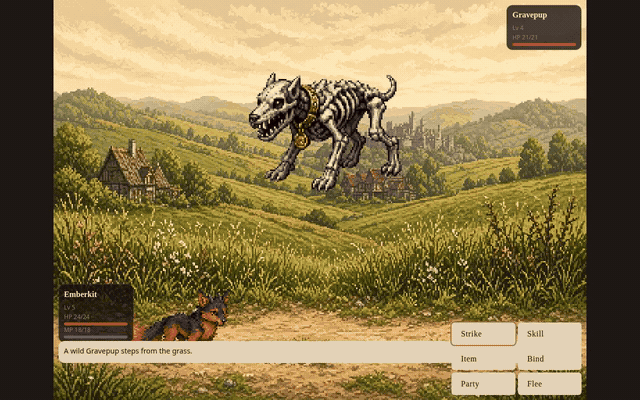
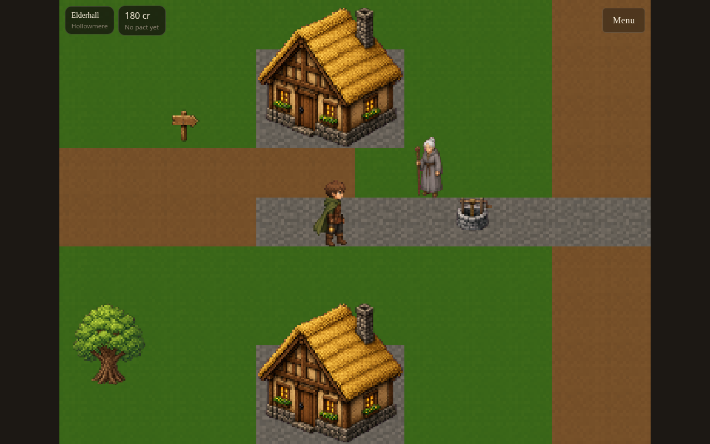
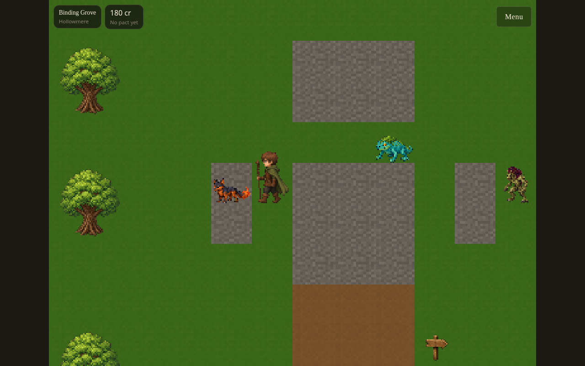
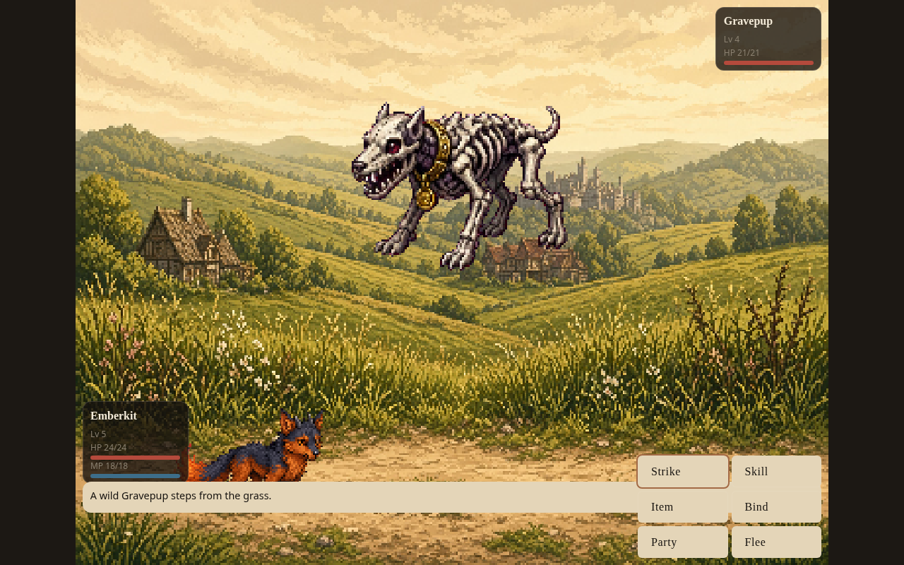
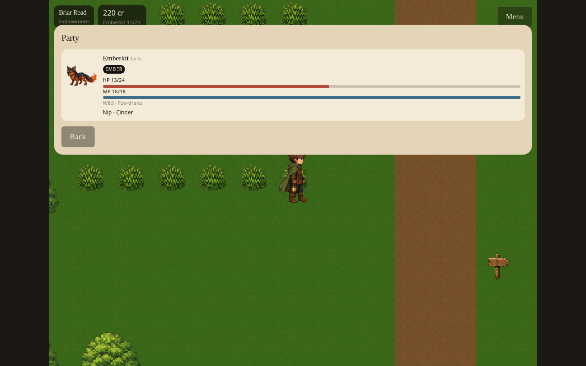
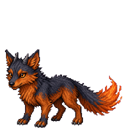
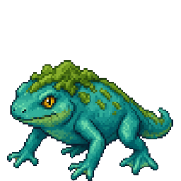
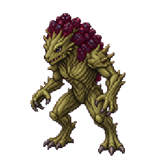

# Reliquary

Reliquary is a medieval-fantasy monster-binding RPG set in Hollowmere. As a
new Pactwarden, bind wild creatures, walk the old roads, and carry the cracked
Crown of Binding's promise forward.

The current prototype includes Elderhall, Binding Grove, Briar Road, Wildwood,
Mirefen, Ashenbarrow, Thornkeep, creature progression/evolution, elemental
battles, binding, party and box storage, items, shops, NPC dialogue, saves, and
keyboard/touch controls.

**Status:** active prototype / gameplay foundation hardening.

## Watch a Pactwarden's first journey

[](docs/showcase/gameplay.mp4)

**[Watch the full gameplay recording](docs/showcase/gameplay.mp4)** ·
[Capture details and reproduction](docs/showcase/README.md) ·
[Meet all 21 creatures](docs/showcase/CREATURES.md)

Actual local browser gameplay operated by AI through keyboard and on-screen
buttons, starting from a fresh game. The silent recording follows Rowan out of
Elderhall, into Binding Grove for a first pact, then onto Briar Road for a wild
battle and binding attempt. The wild binding fails in this take; the starter
pact succeeds. The preview above is an excerpt of that recording.

| Explore Elderhall | Choose your first pact |
| --- | --- |
|  |  |
| **Face a wild creature** | **Keep your party** |
|  |  |

## Meet your first companions

These are **creature artwork from the game's existing runtime assets**, separate
from the gameplay screenshots above.

<table>
<tr>
<td align="center"><br><strong>Emberkit</strong><br>Fox-drake<br>Ember</td>
<td align="center"><br><strong>Mirewhelp</strong><br>River-newt<br>Tide</td>
<td align="center"><br><strong>Briarling</strong><br>Thorn-sprite<br>Verdant</td>
</tr>
</table>

[Browse all 21 creatures, their elements and lore →](docs/showcase/CREATURES.md)

**Current limits:** this is an active prototype. The video demonstrates an
opening session, not a complete playthrough or every evolution. There is no
hosted playable demo linked yet. Gameplay uses local browser saves. Existing art
source/authorship records remain unresolved; see [asset provenance](docs/ASSET_PROVENANCE.md).

## Development

Requires Node.js 24 and npm 11 (see [.nvmrc](.nvmrc)).

```bash
npm ci --legacy-peer-deps
npm run dev
```

The current lockfile needs `--legacy-peer-deps` with npm 11; plain `npm ci`
can reject optional-peer entries. The capture uses that command without changing
the lockfile.

Open http://localhost:8080/ in a browser. WASD or the on-screen pad walks; Z / A
confirms and speaks; X / B cancels; M opens the menu.

Verification commands:

```bash
npm run typecheck
npm run lint
npm test
npm run validate:content
npm run build
```

`npm run build` compiles only. `npm run deploy` is the explicit deployment
orchestration command when a configured deployment database needs migrations.
No production database is required for local tests or builds.

Copyright © 2026 Jonathan Gomez Aguilar. All rights reserved. This is public source
visibility, not an open-source license. GitHub's Terms necessarily provide
limited platform rights for accessing and using GitHub repository features;
outside those limited rights, no general right is granted to copy, modify,
distribute, commercialize, create derivative products from, or otherwise use
Reliquary. See [LICENSE](LICENSE).

## Contribution policy

Outside contributions are not currently accepted as a license or permission to
use the game. Please do not open a pull request expecting rights to reuse the
code, art, lore, names, or creatures. Contact the copyright owner for a
separate written agreement.

## Project notes

- [Architecture](docs/ARCHITECTURE.md)
- [Content system](docs/CONTENT_SYSTEM.md)
- [Asset provenance](docs/ASSET_PROVENANCE.md)
- [Publication and removal status](docs/security/publication-status.md)
- [Security and public-repository notes](docs/SECURITY.md)
- [Brand-risk note](docs/BRAND_RISK.md)
