# Creatures of Hollowmere

[Back to Reliquary](../../README.md) · [Gameplay and capture notes](README.md)

21 creatures from the current prototype. These are **existing shipped creature
artwork**, not gameplay screenshots or newly generated art. Names, epithets,
elements and lore come directly from [the game content](../../src/game/content.ts).
Some forms require progression; this gallery does not claim the opening demo
unlocks every creature.

<table>
<tr>
<td align="center"> <strong>Emberkit</strong> Fox-drake Ember A russet fox-drake whose tail holds a coal that never quite dies. Loyal once the pact is spoken.</td>
<td align="center">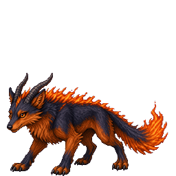 <strong>Pyrefox</strong> Ember fox-drake Ember The coal along its spine has become a ridge of living fire. It runs the old roads at dusk.</td>
</tr>
<tr>
<td align="center">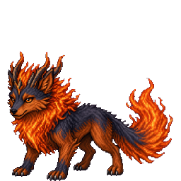 <strong>Crownwyrm</strong> Horn-flame wyrm Ember · Gale A compact wyrm crowned in horn-flame. Old songs say one sat at the Binding King's left hand.</td>
<td align="center"> <strong>Mirewhelp</strong> River-newt Tide A river-newt with a lily-pad crest. It drinks from any stream and remembers every crossing.</td>
</tr>
<tr>
<td align="center">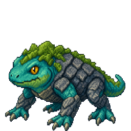 <strong>Riverguard</strong> Stone-backed newt Tide · Stone River-stone plates have grown along its back. Ferrymen leave out fish for it still.</td>
<td align="center">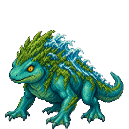 <strong>Tidemark</strong> Wave-crest guardian Tide · Stone Where it walks, the waterline follows. A patient, unkillable kindness.</td>
</tr>
<tr>
<td align="center"> <strong>Briarling</strong> Thorn-sprite Verdant A walking thicket-child. Berry-clusters for hair, and a temper like a bramble patch.</td>
<td align="center">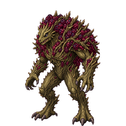 <strong>Thornback</strong> Briar mantle Verdant A living mantle of briar. Hedge-wards use their shed thorns as fence-nails.</td>
</tr>
<tr>
<td align="center">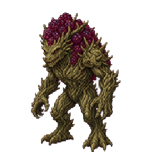 <strong>Elderbramble</strong> Thicket-guardian Verdant · Umbra An old walking wood. Villages that keep one never lose a child to the forest.</td>
<td align="center">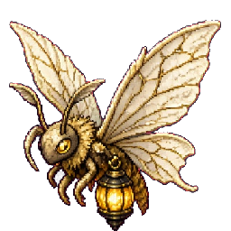 <strong>Mothwisp</strong> Lantern moth Light A cream-winged moth that lights its own belly. Shepherds follow them home in fog.</td>
</tr>
<tr>
<td align="center">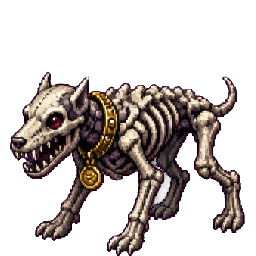 <strong>Gravepup</strong> Bone hound Umbra A hound of pale bone and brass grave-charms. It will not cross a threshold uninvited.</td>
<td align="center">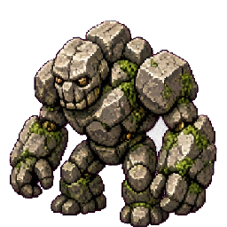 <strong>Pebblet</strong> Living cobble Stone A dog-sized cobble that decided to walk. Mason-wards leave them in walls as luck.</td>
</tr>
<tr>
<td align="center">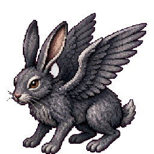 <strong>Galeskip</strong> Storm hare Gale A hare with storm-grey pinions. It is gone before the grass springs back.</td>
<td align="center">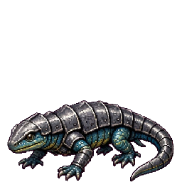 <strong>Ironnewt</strong> Plate newt Steel A newt that grew a smith's leftover iron. Slow, and extremely unwilling to die.</td>
</tr>
<tr>
<td align="center">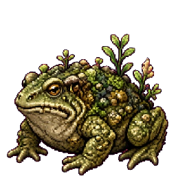 <strong>Bogwallow</strong> Marsh toad Tide · Verdant A fat toad of bog-moss and patience. Its croak is a weather-sign in Mirefen.</td>
<td align="center">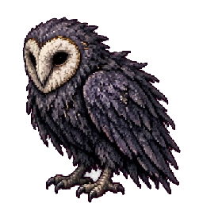 <strong>Hollowowl</strong> Umbra owl Umbra · Gale An owl with a hollow where a heart should be. It hunts by listening to regrets.</td>
</tr>
<tr>
<td align="center">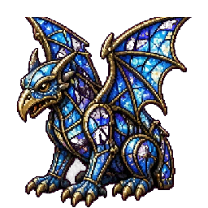 <strong>Chapelite</strong> Glass gargoyle Light · Steel A small gargoyle of chapel glass. Sun through it becomes a weapon.</td>
<td align="center">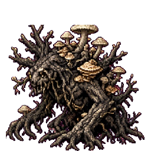 <strong>Rootwight</strong> Knotted wood Verdant · Umbra Black wood and pale fungi. It walks when the compact is broken, and sits when it is kept.</td>
</tr>
<tr>
<td align="center">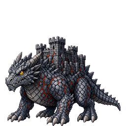 <strong>Keepdrake</strong> Castle wyrm Steel · Ember A keep given a pulse. Ember runs in the seams of its iron-grey hide. Warden-beasts of the old crown.</td>
<td align="center">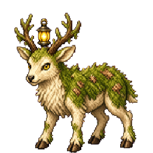 <strong>Sunhart</strong> Lantern stag Light · Verdant A woodland stag with a lantern caught between its antlers. Rare, and unwilling to be hurried.</td>
</tr>
<tr>
<td align="center">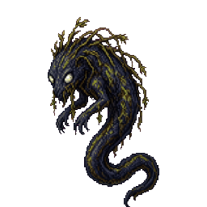 <strong>Fenwitch</strong> Marsh spirit Tide · Umbra Peat-dark water walking. Reed-hair and two pale lantern eyes. It bargains, then it binds.</td>
<td></td>
</tr>
</table>

Regenerate with `node --experimental-strip-types scripts/showcase/gallery.mjs`.

Copyright © 2026 Jonathan Gomez Aguilar. All rights reserved. The repository's
[proprietary license](../../LICENSE) applies. Source/authorship records for the
art remain unresolved as documented in [asset provenance](../ASSET_PROVENANCE.md).
Only existing browser-ready runtime PNGs are referenced here; private source
masters are not included.
